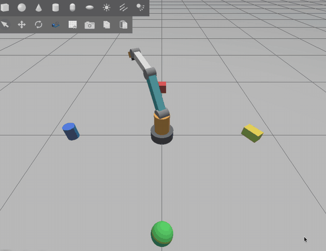

# RA4 — 4 Serbestlik Dereceli Robot Kol (ROS 2 Lyrical + Gazebo Jetty)

BLMU7619 Robot Teknolojileri vize projesi. Kendi tasarımım olan 4-DoF eklemli robot kolun
URDF/Xacro modeli, Gazebo simülasyonu, ros2_control ile eklem kontrolü, düz kinematik hata
analizi, hareket dizisi ve sensör görselleştirmesi.

| | |
|---|---|
| **Geometrik sınıf** | R ⊢ R ∥ R ∥ R (eklemli kol + bilek) |
| **Aktif eklem** | 4 döner eklem (taban, omuz, dirsek, bilek) |
| **Sensörler** | Bilekte IMU (100 Hz) ve kamera (320×240, 10 Hz); eklem durumları; uç efektör konumu |
| **Ortam** | Ubuntu 26.04 arm64 (Parallels, Apple M4), ROS 2 Lyrical, Gazebo Jetty (gz-sim 10) |

## 1. Robot tasarımı

### Linkler ve eklemler

Tüm ölçüler tek bir dosyadan okunur: [`ra4_description/config/geometry.yaml`](src/ra4_description/config/geometry.yaml).
URDF modeli ve Python kinematik kodu aynı dosyayı kullandığı için ikisi her zaman tutarlıdır.

| Frame | Link | Eklem (parent → child) | Eklem ekseni | Öteleme (parent frame'inde) | Limit [rad] |
|---|---|---|---|---|---|
| 0 | `base_link` | `world_joint` (sabit) | — | (0, 0, 0) | — |
| 1 | `turret_link` | `joint1` taban dönüşü | z | (0, 0, h0 = 0.08) | ±3.05 |
| 2 | `upper_arm_link` | `joint2` omuz | y | (0, 0, h1 = 0.17) | ±1.70 |
| 3 | `forearm_link` | `joint3` dirsek | y | (0, 0, l2 = 0.32) | ±2.30 |
| 4 | `wrist_link` | `joint4` bilek | y | (0, 0, l3 = 0.26) | ±2.00 |
| 5 | `tool0` | `tool_joint` (sabit) | — | (0, 0, l4 = 0.11) | — |

- `joint1` ekseni (z) ile `joint2` ekseni (y) omuz noktasında 90° kesişir → **⊢**
- `joint2`, `joint3`, `joint4` eksenleri paraleldir → **∥ ∥**
- q = 0 iken kol dik yukarı bakar; uç efektör (0, 0, 0.94) m'dedir. Erişim yarıçapı 0.69 m.
- Kamera `wrist_link` üzerinde, uç efektör yönüne (+z) bakar (`camera_link`).

### Düz kinematik

Her frame bir öncekine göre z boyunca ötelenir, ardından kendi eklem ekseni etrafında döner:

```
0T1 = Trans(0,0,h0) · Rot_z(q1)
1T2 = Trans(0,0,h1) · Rot_y(q2)
2T3 = Trans(0,0,l2) · Rot_y(q3)
3T4 = Trans(0,0,l3) · Rot_y(q4)
4T5 = Trans(0,0,l4)

0T5 = 0T1 · 1T2 · 2T3 · 3T4 · 4T5
```

Kapalı form (φ2 = q2, φ3 = q2+q3, φ4 = q2+q3+q4):

```
r = l2·sin φ2 + l3·sin φ3 + l4·sin φ4
x = cos q1 · r
y = sin q1 · r
z = h0 + h1 + l2·cos φ2 + l3·cos φ3 + l4·cos φ4
```

Matris çarpımı URDF zincirinden bağımsız bir kütüphaneyle (yourdfpy) 2000 rastgele konfigürasyonda
karşılaştırıldı; en büyük fark 3·10⁻¹⁶ (kayan nokta hassasiyeti).

Herhangi bir konfigürasyonun ara matrislerini yazdırmak için:

```bash
ros2 run ra4_control fk_calc 0.5 0.4 0.6 0.3
```

## 2. Paketler

| Paket | Tür | İçerik |
|---|---|---|
| `ra4_description` | ament_cmake | Xacro modeli, `geometry.yaml`, RViz yapılandırması, `display.launch.py` |
| `ra4_bringup` | ament_cmake | Gazebo dünyası, `sim.launch.py`, ros_gz köprüsü ve ros2_control kontrolcü ayarları |
| `ra4_control` | ament_python | Kinematik kütüphanesi ve node'lar (aşağıda), birim testleri |

`ra4_control` node'ları:

| Komut | Görev |
|---|---|
| `ee_pose_publisher` | Uç efektörün tabana göre konumunu yayınlar: `/ra4/ee_pose` (Gazebo fizik motorundan), `/ra4/ee_pose_fk` (ölçülen açılardan FK) |
| `fk_eval` | 10 konfigürasyonda FK ile Gazebo konumunu karşılaştırır; Öklid hatası, ortalama ve std, CSV çıktısı |
| `sequence` | Başlangıç → A → B → C → başlangıç hareket dizisi (FollowJointTrajectory action) |
| `visualizer` | Eklem açıları, IMU açısal hızı, uç efektör konumu grafikleri ve kamera görüntüsü |
| `fk_calc` | Komut satırından FK hesaplayıcı (rapor için ara matrisler) |

### Topic ve action'lar

| İsim | Tip | Açıklama |
|---|---|---|
| `/joint_states` | `sensor_msgs/JointState` | Eklem açıları [rad] ve hızları |
| `/ra4/ee_pose` | `geometry_msgs/PoseStamped` | Uç efektör, `base_link`'e göre (Gazebo) |
| `/ra4/imu` | `sensor_msgs/Imu` | Bilek IMU |
| `/ra4/camera/image` | `sensor_msgs/Image` | Bilek kamerası, rgb8 320×240 |
| `/arm_controller/joint_trajectory` | `trajectory_msgs/JointTrajectory` | Eklem hedefi (topic), radyan |
| `/arm_controller/follow_joint_trajectory` | `control_msgs/action/FollowJointTrajectory` | Eklem hedefi (action), radyan |

## 3. Kurulum

```bash
mkdir -p ~/ra4_ws && cd ~/ra4_ws
# depoyu klonla ya da arşivi aç (src/ klasörü bu dizinde olmalı)
rosdep install --from-paths src --ignore-src -y
colcon build --symlink-install
source install/setup.bash
```

Gazebo, bu sanal makinede GPU sürücüsü Ogre2 shader'larını derleyemediği için yazılımsal
render ile çalıştırılır (`~/.bashrc` içinde `export LIBGL_ALWAYS_SOFTWARE=1`).

## 4. Çalıştırma

```bash
# Modeli RViz'de incele (kaydırıcılarla eklemleri oynat)
ros2 launch ra4_description display.launch.py

# Simülasyon (Gazebo + kontrolcüler + köprü + uç efektör yayını)
ros2 launch ra4_bringup sim.launch.py            # RViz için: rviz:=true
```

Simülasyon açıkken, ayrı terminallerde:

```bash
# Kontrolcüler aktif mi?
ros2 control list_controllers

# Eklemleri topic ile hareket ettir (radyan)
ros2 topic pub --once /arm_controller/joint_trajectory trajectory_msgs/msg/JointTrajectory \
  "{joint_names: [joint1, joint2, joint3, joint4], points: [{positions: [0.5, 0.6, 0.8, 0.4], time_from_start: {sec: 3}}]}"

# ... ya da action ile
ros2 action send_goal /arm_controller/follow_joint_trajectory control_msgs/action/FollowJointTrajectory \
  "{trajectory: {joint_names: [joint1, joint2, joint3, joint4], points: [{positions: [0.0, 0.0, 0.0, 0.0], time_from_start: {sec: 3}}]}}"

# Sensörleri oku
ros2 topic echo /ra4/ee_pose --once
ros2 topic hz /ra4/imu
ros2 topic hz /ra4/camera/image

# Hata analizi (sonuçlar ~/ra4_results/ altına CSV olarak yazılır)
ros2 run ra4_control fk_eval

# Hareket dizisi + görselleştirme (iki ayrı terminal)
ros2 run ra4_control visualizer
ros2 run ra4_control sequence
```

Birim testleri: `colcon test --packages-select ra4_control && colcon test-result --verbose`

## 5. Tasarım kararları

- **Uç efektörün "ölçülen" konumu Gazebo fizik motorundan alınır** (`PosePublisher` sistemi →
  `/ra4/gz_link_poses` → `ee_pose_publisher`). TF ağacı da aynı URDF'ten aynı formülle
  hesaplandığı için ona göre hata her zaman ~0 çıkardı. Fizik motorundan okunan konum kontrolcünün
  takip hatasını da içerir. `fk_eval` iki hatayı ayrı raporlar:
  - komut edilen açılarla FK – Gazebo (ana metrik)
  - `/joint_states`'ten ölçülen açılarla FK – Gazebo (denklemin doğruluğu, ~0 beklenir)
- **Kamera çözünürlüğü 320×240, 10 Hz.** Sanal makinede kamera görüntüsü işlemcide çiziliyor
  (yazılımsal render). TurtleBot3 Waffle Pi testinde kamera ve lidar açıkken simülasyon hızı
  gerçek zamanın ~%79'undan ~%33'üne düştü; düşük çözünürlük bu yükü azaltır.
- Kamera için referans nesneleri kolun erişemeyeceği mesafeye (0.8 m) konmuştur; çarpışma olmaz.
- Gölgeler, yazılımsal render yükünü azaltmak için kapalıdır.

## 6. Sorun giderme

- **"Another world of the same name is running"**: önceki Gazebo süreci kapanmamış.
  `pkill -9 -f gz-sim-main; pgrep -af gz` (çıktı boş olmalı), sonra tekrar başlat.
- Ağdaki başka bilgisayarların ROS topic'lerini görmemesi için:
  `export ROS_AUTOMATIC_DISCOVERY_RANGE=LOCALHOST`

## Lisans

MIT
